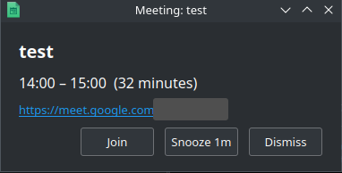
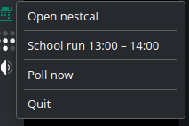
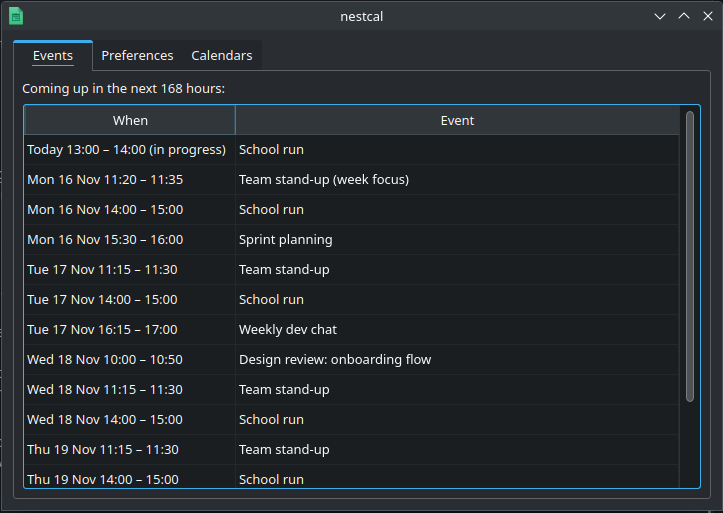
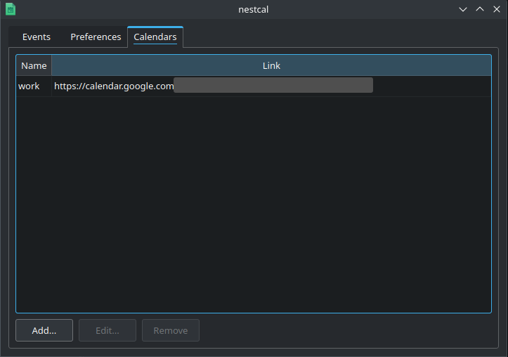
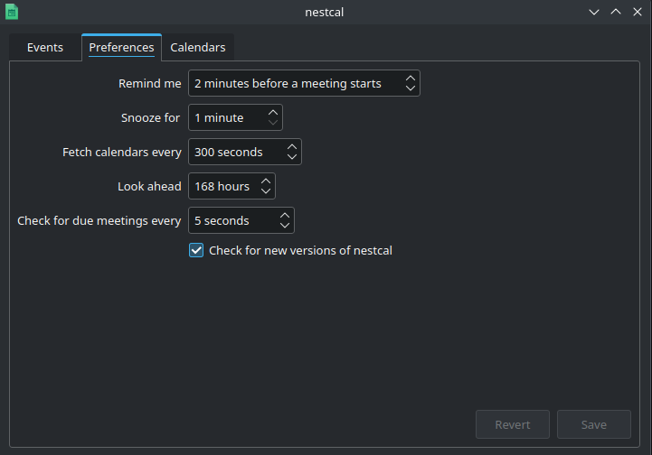

Nestcal
---

A small systray app to monitor an .ics link for a calendar and notify you based on your
own personal preferences before events start.

I kept missing meetings because Thunderbird would only notify if I'd added a notification or if the meeting was originally set up with a notification.

Even when someone added a notification to the meeting, the timing often didn't suit me - I just wanted a heads-up 2 minutes before the meeting.

When a meeting is about to start, nestcal pops a window and keeps it there until you deal with it: join the meeting, snooze for a bit, or dismiss it. Unlike a system notification it never dismisses itself, and it doesn't depend on whether the person who set up the event remembered to add a reminder.



Getting started
---

You'll need an .ics link to your calendar. For Google Calendar, follow the instructions here:
https://support.google.com/calendar/answer/37648?hl=en#zippy=%2Cget-your-calendar-view-only
(use the "Secret address in iCal format"; it's a secret, so keep it private).

Run nestcal. With no calendars configured it asks for a name (eg "work") and the .ics link, and
saves them to `~/.config/nestcal/config.ini`. After that it lives in your system tray, and everything
else can be done from its window: there's no need to edit a config file by hand (though you can).

Using nestcal
---

Open the window by **left-clicking** the tray icon, or **double-clicking** it, or by choosing
**Open nestcal** from the tray menu (right-click the icon). On macOS clicking the icon in the menu
bar shows the menu, so use "Open nestcal" there.



The tray menu also lists any meeting that is in progress or about to start; choosing one brings
its reminder back, which is handy if you dismissed it too early. "Poll now" fetches your calendars
immediately, and "Quit" is the only way to stop nestcal: closing the window just hides it, and
reminders carry on.

Mouse over the tray icon to see the next upcoming event.

### Events



Everything coming up in the look-ahead window (24 hours by default, but you can choose your own look-ahead window), soonest first, including anything already in progress. Events that have ended drop off by themselves. Double-click an event to see all of it: when, which calendar it's from, and its meeting link (Google Meet, Zoom, Teams and the like), which you can click to join. That's a second way in for a meeting whose reminder you've already dismissed.

When a newer version of nestcal has been released, a link to the releases page appears at the top of this tab.

### Calendars



The calendars nestcal watches. **Add**, **Edit** (or double-click a row) and **Remove** them; each change is saved straight away. The add/edit dialog has a **Test link** button, which fetches the link and tells you whether it's reachable and really is a calendar, so you find out about a typo now rather than when a reminder fails to appear.

### Preferences



| Setting                         | What it does                                                          |
|---------------------------------|-----------------------------------------------------------------------|
| Remind me                       | how long before a meeting starts its reminder pops up                 |
| Snooze for                      | how long Snooze hides a reminder before it pops up again              |
| Fetch calendars every           | how often your calendar links are fetched                             |
| Look ahead                      | how far ahead events are fetched and shown                            |
| Check for due meetings every    | how often nestcal looks for a meeting that is due or already started  |
| Check for new versions          | whether to ask GitHub now and then if a newer nestcal exists          |

Changes are only written when you press **Save** (**Revert** goes back to what's in the file), and they take effect immediately: there's no need to restart.

The config file
---

Everything above is stored in `~/.config/nestcal/config.ini` (mode 600, because the links are secrets). You're welcome to edit it by hand instead:

```
# nestcal config
# One entry per calendar under [calendars] as: label = ICS_URL
# Use the Google Calendar "Secret address in iCal format".
# These URLs are secrets.

[settings]
# how often to poll the .ics link, in seconds
poll_interval = 300
# pop up a notification this many minutes before a meeting is due to start
lead_minutes = 2
# only consider the next 24 hours for current processing
window_hours = 24
# how long snooze should snooze for
snooze_minutes = 1
# how often, in seconds, to check for anything that may have slipped
#  through the cracks, eg a meeting for now that was only discovered
#  during startup, or a meeting you weren't in, which has already been
#  started, and you've just been added
check_interval = 5
# ask GitHub now and then whether a newer nestcal has been released
check_for_updates = true

[calendars]
work = https://calendar.google.com/calendar/ical/...
home = https://calendar.google.com/calendar/ical/...
```

nestcal watches the file: save a change in your editor and it's applied within a second, and the window follows. Saving from the window keeps your comments and anything it doesn't touch exactly as it was. If you save a file nestcal can't make sense of (a calendar name used twice, a setting that isn't a number), it carries on with the last good settings and says so in a red banner at the top of the window until you fix it.

Earlier releases kept this file at `~/.config/nestcal.ini`. On first launch nestcal moves it to
its new place (a symlink stays a symlink to the same file), and refuses to start, saying why, if it
can't. If a file already exists at the new place, that one is used, and the old one is reported at
each start and left alone until you delete it.

Update check
---

Release builds ask GitHub for the latest release when they start, and then once a day. If there's a newer one, a link to the releases page appears at the top of the Events tab, and a dialog offers to open it. Since someone who dismisses that dialog may just be busy, it comes back after 2 days, then again after 4 more, and then leaves you alone about that release (the link stays).
A still-newer release starts the schedule again. What it remembers for this is kept in
`~/.config/nestcal/state.json`, which is safe to delete.

Untick **Check for new versions** in Preferences (or set `check_for_updates = false`) to stop all of it. Source and `./build.sh` builds are unstamped ("dev") and never check. A failed check is silent; run with `--debug` to see why.

Requirements
---

- Python 3 and pyqt6 or pyqt5 (failover for older machines)
- Python libs:
  - requests
  - icalendar
  - recurring_ical_events

Run it with `python nestcal_tray.py` (add `--debug` to see what it's doing).

Tests
---

```
pip install -r requirements-test.txt   # or requirements-test-qt5.txt to test the Qt 5 path
python -m pytest
```

`tests/` holds fast unit tests of the core logic: parsing calendars, reading and writing the
config file, formatting, update checking. `tests/ui/` drives the real app, offscreen (no display needed), against a fake `.ics` feed served from the test process: reminders, the tray menu and tooltip, the main window and each of its tabs, live config changes, the update flow and the fallback icon.

CI runs them on Linux (Qt 6 and Qt 5) and Windows, and a release is only built and published
if they pass.

Standalone apps (work in progress)
---

Every push to master publishes a release with standalone apps for macOS (Apple Silicon
and Intel), Linux and Windows; download them from the Releases page. Pushes to other
branches publish `-beta` pre-releases, which are never marked as the latest release. The `build` workflow also keeps them as artifacts. To build locally instead, run `./build.sh` on the machine you want to run it on. On macOS the app lands in `dist/Nestcal.app`;
elsewhere it's `dist/nestcal/Nestcal`.

macOS
---

There are two builds per architecture. The default one needs **macOS 13 or later** (it uses Qt 6). On macOS 11 or 12, download the `-qt5` build instead (`nestcal-macos-amd64-qt5.zip` for Intel, `nestcal-macos-arm64-qt5.zip` for Apple Silicon); it uses Qt 5.15, which still runs there. Without it, a too-new macOS requirement makes the app quit at once with no window and no config file.

The app lives in the menu bar only: no Dock icon. Click its icon and choose **Open nestcal** to get to the window.

Before the first launch:

1. Launch the app: with no calendars configured it asks for a name and .ics link and writes
   `~/.config/nestcal/config.ini` (mode 600) for you.
2. If you downloaded the app from CI rather than building it, macOS will refuse
   to open it because it isn't notarized. Run `xattr -cr Nestcal.app` once, or
   right-click the app and choose Open.

If nothing appears in the menu bar, run it from a terminal to see what went wrong:

```
Nestcal.app/Contents/MacOS/Nestcal --debug
```

Known limitations on macOS:

- The "next event" tooltip doesn't show in the menu bar.
- The reminder window may not appear over full-screen apps or take keyboard focus.
- Recent PyQt6 releases need a recent macOS. If the app won't start on an older
  one, please report your macOS version.

Linux and Windows
---

Run `dist/nestcal/Nestcal` (`Nestcal.exe` on Windows); add `--debug` from a terminal
to see what it's doing. If no calendars are configured it asks for one on first run, as on macOS.

- Linux: GNOME needs the AppIndicator extension to show tray icons.
- Windows: the exe isn't signed, so SmartScreen will warn on first run.
